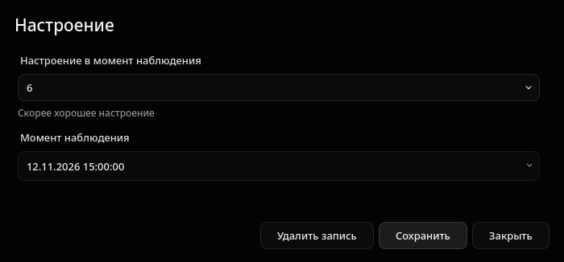
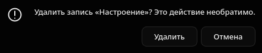
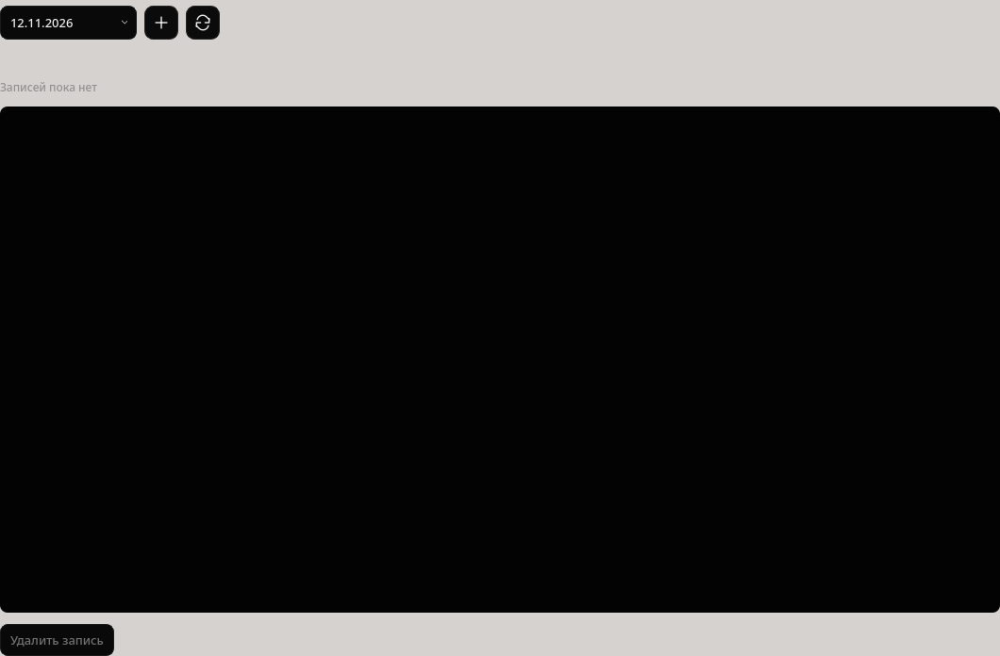

# Удаление записей

Добавлено явное удаление сохранённой записи из окон всех семи типов. В Дневнике
кнопка «Удалить запись» постоянно видна и доступна после выбора записи.
В новой несохранённой форме удаления нет.

Перед удалением показывается подтверждение; по умолчанию выбрана «Отмена».
При несохранённых правках есть дополнительное предупреждение. Ошибка сохраняет
ввод и позволяет повторить попытку. Успех обновляет Дневник и график через
существующие механизмы, устаревшее действие «Открыть запись» очищается.
Используется прежний ApplicationSession.diary.delete; SQL, схема, Domain,
Application, Infrastructure и резервирование не менялись.
Удаление окончательное, корзина и массовое удаление не добавлялись.

## Проверки

- 11 новых сценариев: все семь типов, отмена/подтверждение, rollback при ошибке,
  повторная попытка, 64-битный ID и отсутствие удаления в новой форме.
- Связанные проверки: 48 passed, 1 warning.
- Финальная полная регрессия: **1238 passed, 7 прежних warnings**, 167.16 с.
- compileall и pip check успешны.
- Проверки и снимки выполнены в фоне на отдельном виртуальном KWin Wayland,
  с искусственной SQLite и отдельными QSettings. Личная база не открывалась.
- Независимая onedir-проверка из /tmp без исходников, .venv и системного Python:
  семь форм, удаление, ECharts, backup/restore и повторное открытие успешны;
  Chromium sandbox сохранён (Seccomp=2). В логе виртуальной сессии остаются
  предупреждения portal/Mesa и завершения WebEngine; проверка status=ok.

## Снимки

## Файлы и запуск

Добавлены presentation/record_actions.py, tests/ui/test_record_deletion.py,
tests/manual/virtual_wayland.py и tests/manual/record_deletion_preview.py.
Изменены presentation/forms/common.py, presentation/diary.py,
presentation/main_window.py, packaging/bundle_check.py и документация.
Пути Presentation указаны относительно src/healthtracker/.

Новая сборка: dist/stage7-black-hole-4-delete/healthtracker/healthtracker.
Предыдущая clock сохранена. Локальный ~/.local/bin/tracker направлен на новую
сборку. Закройте прежнее окно и выполните `tracker` из любого каталога.
Git-коммиты и отправка на GitHub не выполнялись.
