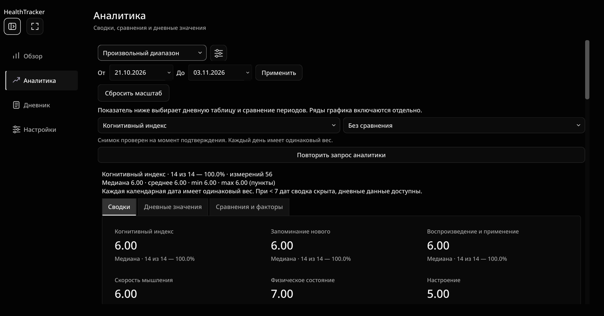
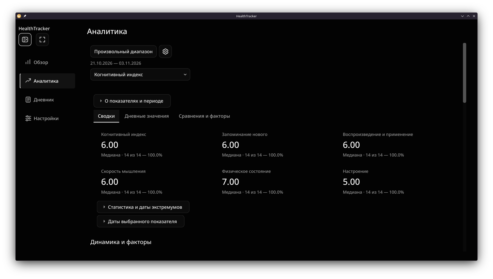
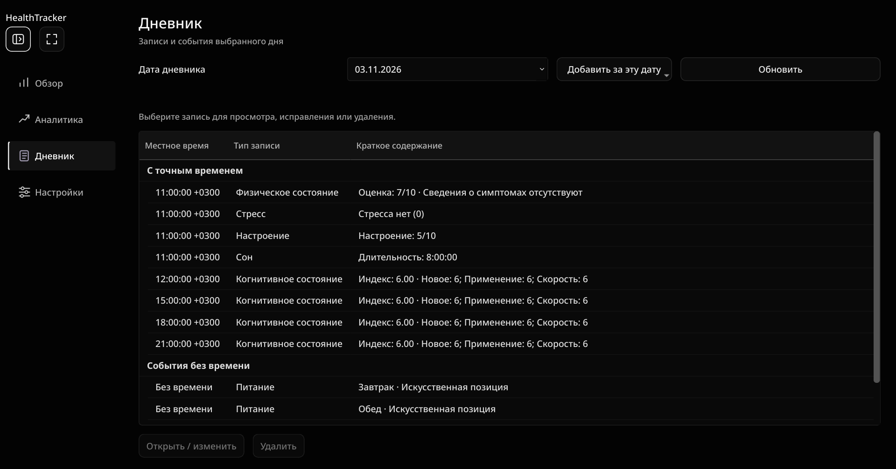
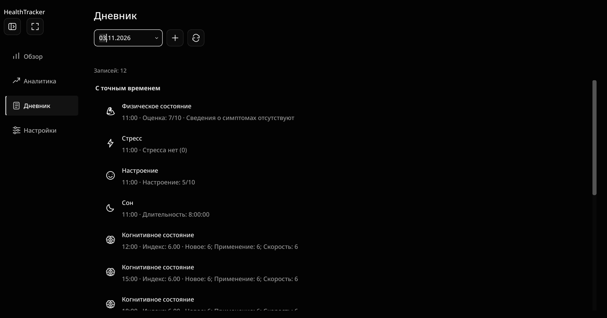
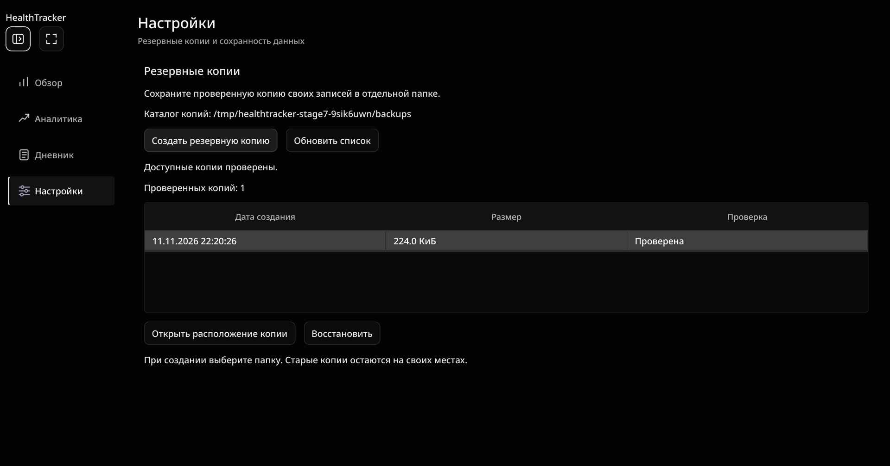
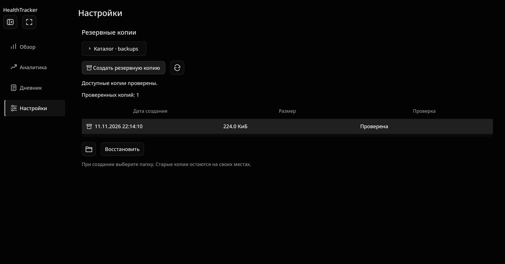
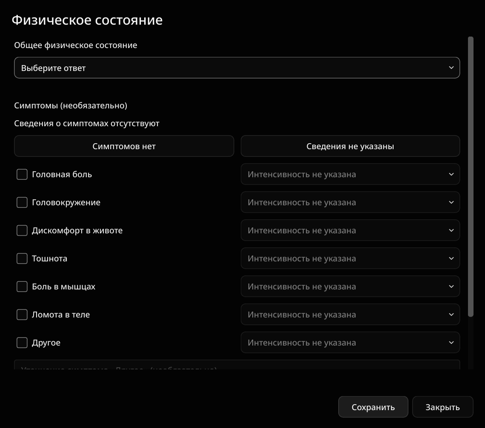
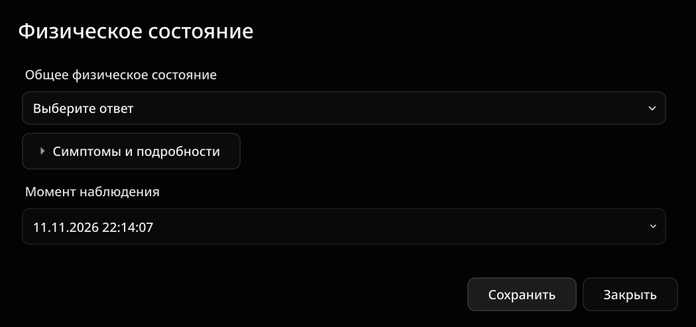
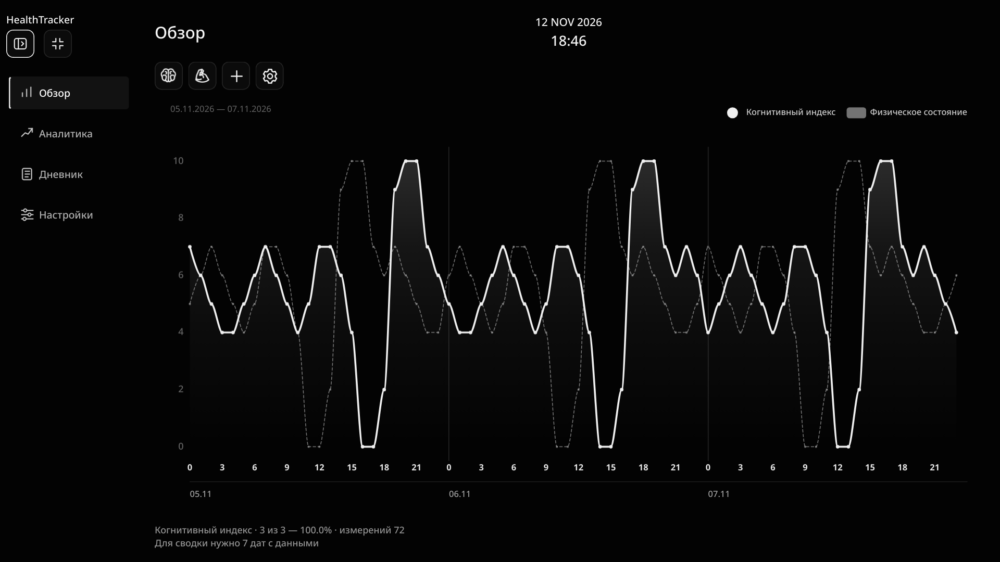

# HealthTracker — BLACK HOLE 4.0

## Задача и исходное состояние

Контрольная точка BLACK HOLE 3.0 со шестерёнкой завершена: 1221 тест,
предыдущая onedir stage7-black-hole-3-gear. Перед правками прочитаны AGENTS,
handoff, план и последний отчёт, проверены реальные классы Presentation.
Все проверки этой работы используют искусственную SQLite и отдельные QSettings.

Снимки до показали: фильтры и технические пояснения вытесняли статистику вниз;
Дневник имел три широкие колонки; пути копий и вторичные действия занимали
слишком много места; формы были одинаково высокими независимо от содержимого.
В подтверждении восстановления оставались системный оранжевый значок и Yes/No.

## Общие правила

Почти чёрный #030303, поверхности #0B0B0B–#141414, вторичный текст #929292,
тонкие разделители #242424. Noto Sans 500 с прежним fallback, заголовки 600.
Кнопки 32–36 px, радиусы 8–12 px, без декоративных теней и цветных акцентов.
Основные изменения собраны в theme.py: Disclosure, icon_button, quiet_table,
style_calendar, style_message_box и show_warning. Это небольшие компоненты Presentation,
без новых моделей, хранилищ или механизмов синхронизации.

Таблицы без полной сетки и внешних тяжёлых рамок; вкладки спокойнее.
Поля и календари согласованы, выходные календаря монохромные. Для выбранных
SVG и пиктограмм навигации задана собственная монохромная иконка, чтобы Plasma
не подкрашивала их своим системным цветом. У иконочных действий есть tooltip
и доступное название. Новый набор собственных SVG: обновление, папка, архив,
сон, питание, зал, настроение, стресс и предупреждение. Мозг/бицепс/плюс/шестерёнка
переиспользованы. Библиотеки и системные шрифты не устанавливались.

## Аналитика

Вверху компактное действие выбора периода, шестерёнка, фактический диапазон дат
и выбор показателя. Параметры используют прежний ChartControls и уже существующий
ChartSettingsPopup; сравнение периодов и его даты перенесены туда же. Нового popup
или альтернативного пути вычислений нет. Открытие настроек не отправляет запрос.

Сводки — шесть лёгких блоков без отдельных серых карточек. Название, медиана
и покрытие остаются видимы. Подробная таблица, даты экстремумов и пояснения
раскрываются отдельно; полные значения не удалены. Сохранены дневная таблица,
сравнения недель/месяцев/произвольных диапазонов, исключённые даты сна и зал.
Все существующие факторные графики и прежний ECharts сохранены; JS/CSS графика
не переписывались. Кнопка повтора видна при ошибке, успешное подтверждение
снимка больше не занимает строку техническим сообщением.

## Дневник

Существующий QTreeWidget показывает двухстрочную ленту через DiaryDelegate.
Заголовок таблицы скрыт, колонки модели сохранены: тип/полный текст/ID не потеряны.
У записи монохромная пиктограмма, название типа, местные часы и краткое содержание.
Длинная строка визуально сокращается; полный текст доступен в tooltip и после выбора.
При выборе появляется полное содержание с прокруткой и прежние действия
«Открыть / изменить» и «Удалить». Двойной клик и Enter сохранены; Delete по-прежнему
требует подтверждения. Дата и текущий часовой пояс не меняют исходные UTC-моменты.
Для доступности задан полный AccessibleTextRole.

Вверху компактная дата, плюс с прежним меню семи типов и обновление.
Пустое состояние: «Записей пока нет», пустые группы не показываются.
Новые фильтры, периоды и сортировки не добавлялись: сохранён прежний дневник даты.

## Настройки и резервные копии

В этом прототипе существующие настройки страницы относятся к резервированию;
новые продуктовые параметры не добавлялись. Полный каталог перенесён в
«Каталог · имя папки», раскрывается и остаётся доступен для выделения/копирования.
Создание копии — текстовая кнопка с пиктограммой архива, обновление и открытие
расположения — компактные иконочные действия. Высота списка соответствует числу
копий, а не пустому большому прямоугольнику. Дата, размер и результат проверки видны.

Восстановление остаётся отдельной текстовой кнопкой. Реальный QMessageBox теперь
монохромный, кнопки «Восстановить» и «Отмена», отказ по умолчанию. Полный текст о
замене данных, повторной проверке, защитной копии и обязательном перезапуске сохранён.
Менялось создание диалога, а не Application/Infrastructure или порядок восстановления.

## Семь форм, уведомления и подтверждения

Общий EntryDialog управляет шириной, отступами, высотой по содержимому и прокруткой.
Короткие формы не получают искусственно большую пустую высоту; длинные ограничены
доступным экраном, кнопки сохранения/закрытия находятся вне прокручиваемой области.
Во всех формах одинаковые поля, заголовки групп, Floating UI списки и календарь.
Пояснение числовой шкалы остаётся видимым при выборе оценки; пустая подпись
не создаёт лишний промежуток. Описания шкал и их версии не менялись.

Физическое состояние: симптомы в раскрываемой секции. Стресс: причины и комментарий
в отдельной секции, предупреждение об очистке при 0 остаётся постоянно видимым.
В формах редактирования секции раскрыты. Это перенос прежних виджетов, без изменения
state/persist или значений по умолчанию. Питание сохраняет все позиции и поля;
добавленные позднее позиции используют тот же вид списка кофеина.

Ошибки ввода показываются текстом в общем заметном блоке и не теряют введённое.
Обычное сохранение оставляет прежнее кратковременное сообщение, без нового модального
успеха. Подтверждение удаления и отказа от несохранённого ввода — монохромные,
с русскими действиями и безопасным выбором по умолчанию. Тем же способом
оформлены предупреждения о повторе питания, длинном сне и недоступной записи. Ошибки хранилища,
занятости, резервирования и требования перезапуска не скрыты.

## Снимки до/после

Скрипт: tests/manual/black_hole_4_preview.py. Все снимки сделаны в настоящем Wayland.
Папки: `/tmp/healthtracker-black-hole-4/{before,after}/{1,1.5,2}/`.
Исходные снимки всех страниц и семи форм сохранены до изменения production-кода.
После также сняты семь форм редактирования, раскрытые секции, параметры Аналитики,
вложенный Floating UI, подробности и пустой Дневник, подтверждение восстановления,
календарь, узкое окно, свёрнутая навигация и F11. Снимки просмотрены, в том числе
крупно на 200%. Файлы в /tmp могут быть очищены системой.

| Раздел | До, 150% | После, 150% |
|---|---|---|
| Аналитика |  |  |
| Дневник |  |  |
| Копии |  |  |
| Форма |  |  |

## Файлы

Изменены Presentation: theme.py, analytics_page.py, diary.py, backup_page.py,
main_window.py (убран повторяющийся подзаголовок), chart_controls.py (календарь),
forms/common.py, forms/physical.py, forms/stress.py, forms/meal.py, forms/sleep.py.
Добавлено девять SVG в resources/chart/ui-*.svg.
Добавлены tests/ui/test_black_hole_4.py (четыре пользовательских сценария) и
manual/black_hole_4_preview.py. test_diary.py адаптирован к общему show_warning для ошибки открытия записи.
test_restore_ui.py адаптирован к экземпляру QMessageBox:
по-прежнему проверяет текст предупреждения, дату, размер и отказ по умолчанию.
Документация: этот отчёт, handoff, development_plan, architecture, AGENTS и README.

## Оставшиеся ограничения

Длинные формы, таблицы и факторные графики требуют прокрутки на небольшом экране.
У Аналитики сохранён прежний большой canvas с несколькими графиками, новая система
переключения отдельных canvas не добавлялась. Дневник остаётся дневником выбранной
даты; новых фильтров нет. Короткая строка ленты сокращает длинное содержание,
но полная версия доступна при выборе и в форме. Ручная эстетическая оценка
пользователем остаётся отдельной от выполненных автоматических сценариев.


## Итог проверок и сборка

Добавлено четыре сценария: параметры/подробности Аналитики без лишнего запроса,
выбор записи ленты и полный текст, раскрываемые секции форм с сохранением оценок,
компактный проверенный список копий с доступным полным каталогом.
Полная регрессия финального production-кода: **1225 passed, 7 прежних warnings,
109.17 с**. Основные пользовательские сценарии в Wayland: **150% — 234 passed,
7 warnings (36.89 с); 200% — 234 passed, 7 warnings (36.66 с)**.
На 100% выполнен полный прогон. compileall и pip check успешны.

52 Python-модуля Domain/Application/Infrastructure сравнены как code objects
с PYZ предыдущей stage7-black-hole-3-gear: отличий нет. Все 18 прежних ресурсов
графика совпадают с прежней onedir. В новой onedir проверено совпадение всех
27 ресурсов и 20 модулей Presentation с исходниками. Схема/миграции/расчёты,
WebChannel, рабочие задачи и backup/restore не менялись.

Сборка создана существующим spec:

```bash
.venv/bin/python -m PyInstaller --noconfirm \
  --distpath dist/stage7-black-hole-4 --workpath build/stage7-black-hole-4 \
  packaging/healthtracker.spec
./dist/stage7-black-hole-4/healthtracker/healthtracker
```

Предыдущая stage7-black-hole-3-gear и остальные рабочие сборки сохранены.
Новая onedir прошла --check-bundle в настоящем Wayland через независимый read-only
/opt/healthtracker с cwd=/tmp. Исходники, .venv и системный Python были скрыты,
PATH пустой, сеть изолирована bwrap. Результат status=ok, platform=wayland,
loaded_from_venv=false, renderer_seccomp=[2]. Chromium sandbox не отключался.
Семь типов сохранены, проверены графики/ECharts 6.0.0, создание/список копий,
восстановление с настоящим подтверждением, повторный процесс и QSettings.
После восстановления по 15 записей всех семи типов. База вне onedir.
Снимки упакованной версии — /tmp/healthtracker-black-hole-4/frozen/.

При визуальной проверке выявилась особенность съёмки: скрытие только содержимого
календаря оставляло его нативный контейнер; драйвер изменён на Escape с проверкой
закрытия окна. Съёмка Spectacle до завершения анимаций KWin также могла захватить
временную пустую поверхность. Перед снимком композитора добавлена выдержка 800 мс,
это не способ синхронизации рабочих задач или конкурентных тестов.
Обычные проверки ожидают сигналы/состояния, а не задержки. Production ради съёмки
не менялся. Финальные fullscreen-снимки Spectacle на 100/150/200% просмотрены после завершения анимации: пустой поверхности нет, рамки и панели задач отсутствуют.
Прежние предупреждения WebEngineProfile при закрытии, deprecated setActiveWindow,
GBM/Vulkan fallback и Wayland об отсутствии input serial при синтетическом popup
не скрывались; пакеты и системные настройки не менялись.

Посмотреть с готовыми искусственными почасовыми данными, из любой папки:

```bash
bash /home/Guts/Downloads/projects/HealthTracker/demo/hourly-4-to-7/run-demo.sh
```

Это запуск актуальных исходников с отдельной демонстрационной SQLite, не личной базы.
Для новой onedir запускайте приведённый выше исполняемый файл; все файлы её
каталога, включая _internal, нужны для работы. Пользовательские XDG-пути прежние.


Основные снимки сохранены в `docs/screenshots/black-hole-4/`, независимо от очистки
/tmp. Исходные временные снимки «до» были очищены между сеансами; сравнение
повторно снято из неизменённого Presentation прежней onedir stage7-black-hole-3-gear
(код её PYZ загружен только в отдельном тестовом процессе, исходники не откатывались).
Backend совпадает с этой версией, используются те же искусственные данные.
В таблице выше — сохранённые изображения. Дополнительно:
[панель Аналитики](screenshots/black-hole-4/after-analytics-settings-150.png),
[подробности записи](screenshots/black-hole-4/after-diary-details-150.png),
[подтверждение](screenshots/black-hole-4/after-confirmation-150.png),
[fullscreen 100%](screenshots/black-hole-4/fullscreen-100.png),
[150%](screenshots/black-hole-4/fullscreen-150.png), [200%](screenshots/black-hole-4/fullscreen-200.png).
Семь форм до/после также сохранены рядом. Проверки завершены, следующий этап не начинался.


Для сохранённого снимка Аналитики «после» использован Spectacle активного окна:
QWidget.grab с WebEngine в отдельных прогонах давал неполный кадр. Это видно
в диагностических временных снимках; они не использованы как финальный образец.
В кадре Spectacle видна стандартная рамка Plasma, её цвет задаётся системой.
В fullscreen рамки нет. Системная тема и настройки оконного менеджера не менялись.


## Дополнение: дата и часы в Обзоре

В верхней части Обзора по центру рабочей области добавлен OverviewClock:
дата `11 MAY 2026`, под ней местное время `16:38`. Месяцы — фиксированные
английские сокращения верхним регистром, независимо от локали интерфейса.
Noto Sans, белый текст #F2F2F2, вес 600; дата 14 px, время 18 px.
QTimer раз в секунду проверяет системное местное время, меняя текст только
при необходимости. При скрытии Обзора таймер останавливается, при возврате
дата и время обновляются сразу. Это отдельные часы, не выбранная дата графика.
Запросы/период/zoom и данные графика не меняются от тиков часов.

Production: новый presentation/overview_clock.py, интеграция в main_window.py,
два общих текстовых стиля в theme.py. Два новых UI-сценария в test_overview_clock.py.
Реальные снимки Spectacle: tests/manual/overview_clock_preview.py,
docs/screenshots/overview-clock/{overview,collapsed,narrow}-{100,150,200}.png.
Просмотрены fullscreen, свёрнутая навигация и узкое окно, центрирование проверено.

Полный прогон обнаружил прежний тест, предполагавший повторный час в Havana
в ноябре 2026. В установленной zoneinfo на этих датах повторного часа уже нет.
В tests/unit/test_display_continuity.py взята историческая дата 2 ноября 2025,
дополнительно проверен fold=1; прежние проверки сегментов и координат сохранены.
Расчёты/Domain/Application не изменялись. В первом прогоне также был разовый
сбой клика по раскрытию рядов; отдельный повтор этого UI-сценария прошёл.


Итог дополнения: 13 связанных UI-проверок и пять проверок непрерывности прошли.
Полная финальная регрессия — **1227 passed, 7 прежних warnings (154.66 с)**,
два новых сценария. compileall и pip check успешны. Новая onedir:
`dist/stage7-black-hole-4-clock/healthtracker`, прежняя BLACK HOLE 4 сохранена.
Существующая команда `~/.local/bin/tracker` переключена на новую сборку.
Запуск `tracker --check-bundle` из /tmp в Wayland проверяет только искусственную
базу. Git-коммиты и отправка на GitHub в этом дополнении не выполнялись.


